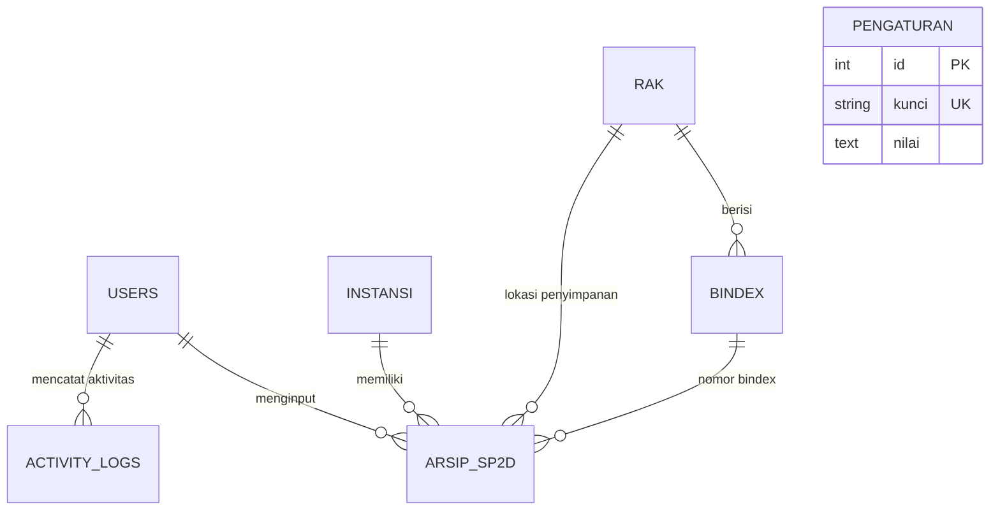

# 📁 Sistem Informasi Manajemen E-Arsip SP2D

<div align="center">


**Aplikasi Berbasis Web untuk Digitalisasi, Tata Kelola, dan Efisiensi Pengarsipan Dokumen Surat Perintah Pencairan Dana (SP2D)**

[Fitur Utama](#-fitur-utama) •
[Teknologi](#-teknologi-yang-digunakan) •
[Instalasi](#-panduan-instalasi--penggunaan) •
[Hak Akses](#-hak-akses-pengguna-rbac) •
[Struktur Database](#-struktur-database)

</div>

---

## 📌 Tentang Project

**E-Arsip SP2D** adalah sistem informasi manajemen arsip digital yang dikembangkan untuk mengatasi permasalahan pengelolaan arsip fisik dokumen keuangan daerah, khususnya Surat Perintah Pencairan Dana (SP2D). 

Sistem ini berfungsi sebagai **Buku Induk Digital**, menjembatani dokumen fisik dan digital dengan memetakan lokasi fisik arsip (Gedung, Rak, hingga Nomor Bindex) sekaligus menyimpan salinan digital (*soft copy* PDF). Sistem ini dirancang untuk mempercepat proses temu-kembali arsip (*zero-time searching*), mengamankan riwayat penanganan dokumen, serta menyajikan pelaporan otomatis yang sesuai dengan standar Badan Pengelolaan Keuangan dan Aset Daerah (BPKAD).

---

## ✨ Fitur Utama

### 1. 🗄️ Manajemen Dokumen & Arsip SP2D
- **Pencatatan Metadata Lengkap:** No. SP2D, No. SPM, Tanggal SPM, Tanggal SP2D, Instansi/SKPD, Jenis & Nama Kegiatan, Jumlah Halaman, dan Jumlah SP2D.
- **Integrasi Lokasi Fisik:** Penentuan rak otomatis tersinkronisasi dengan master data Bindex.
- **Upload & Viewer PDF:** Unggah dan unduh berkas digital SP2D secara aman.
- **Status Peminjaman & Pengembalian:** Pelacakan status fisik dokumen (Disimpan, Dipinjam, Dikembalikan).
- **Recycle Bin (Soft Delete):** Proteksi data dari penghapusan tidak disengaja dengan opsi *Restore* atau *Hapus Permanen*.

### 2. 📊 Laporan Dinamis & Export Fleksibel
- **Filter Fleksibel:** Filter laporan berdasarkan rentang tanggal, instansi (SKPD), dan status arsip.
- **Cetak Laporan PDF / Print:** Dilengkapi format resmi lengkap dengan **Kop Surat Dinamis** dan **Tanda Tangan Pejabat**.
- **Kustomisasi Pengaturan Laporan:** Ubah Nama Pejabat, NIP, Jabatan, Lokasi, dan Kop Surat langsung melalui antarmuka web tanpa menyentuh kode program.
- **Export Excel Profesional:** Format Excel terstruktur dengan sistem **pengelompokan (grouping) otomatis per SKPD/Instansi** serta perhitungan akumulasi otomatis (Total Halaman & Total SP2D).

### 3. 🏢 Master Data Terpadu
- **Data Instansi / SKPD:** Manajemen instansi pemerintah daerah pengaju SP2D.
- **Data Rak Arsip:** Pengelolaan kode rak, nama rak, lokasi ruang, kapasitas total, dan jumlah arsip terisi.
- **Data Bindex:** Nomor bindex dan keterangannya yang terhubung langsung ke rak spesifik.
- **Data Kegiatan:** Klasifikasi jenis kegiatan dan nama sub-kegiatan anggaran.

### 4. 🛡️ Keamanan & Tata Kelola
- **Role-Based Access Control (RBAC):** Pembagian hak akses berjenjang (Admin, Operator, Reviewer, Management, Direktur).
- **Audit Trail (Activity Logs):** Pencatatan riwayat aktivitas pengguna (Login, Tambah, Edit, Hapus, Cetak, Export, Download, Restore).
- **Database Backup & Restore:** Pencadangan basis data berkala langsung dari sistem.
- **Keamanan Siber:** Menggunakan PHP PDO (*Prepared Statements*) untuk mencegah SQL Injection, Password Hashing (`bcrypt`), proteksi XSS, dan validasi file upload ketat.

### 5. 🎨 Antarmuka Modern & Responsif
- Desain antarmuka bersih berbasis **Bootstrap 5** dan tipografi **Outfit**.
- Pencarian dan filter instan menggunakan **DataTables**.
- Visualisasi ringkasan statistik dan grafik interaktif berbasis **Chart.js**.
- Notifikasi interaktif menggunakan **SweetAlert2**.
- Dukungan beralih tema **Dark Mode** dan **Light Mode**.

---

## 🛠️ Teknologi yang Digunakan

| Komponen | Teknologi | Keterangan |
| :--- | :--- | :--- |
| **Back-End** | PHP 8.x | Native MVC Architecture |
| **Database** | MySQL / MariaDB | Relational Database Management System |
| **Database Driver** | PDO (PHP Data Objects) | Keamanan query dengan Prepared Statements |
| **Front-End** | HTML5, CSS3, JavaScript | Responsive Layout |
| **UI Framework** | Bootstrap 5.3 | Komponen UI modern & grid responsif |
| **Icons & Font** | Font Awesome 6 & Google Fonts (Outfit) | Ikonografi & tipografi profesional |
| **Plugins** | DataTables, Chart.js, SweetAlert2 | Interaktivitas tabel, analitik, & modal |

---

## 👥 Hak Akses Pengguna (RBAC)

Aplikasi memiliki 5 tingkat otorisasi pengguna dengan matriks hak akses sebagai berikut:

| Modul / Menu | Admin | Operator | Reviewer | Management | Direktur |
| :--- | :---: | :---: | :---: | :---: | :---: |
| **Dashboard & Statistik** | ✅ | ✅ | ✅ | ✅ | ✅ |
| **Manajemen Arsip (Input / Edit)** | ✅ | ✅ | ⚠️ *(Review)* | ❌ | ❌ |
| **Detail & Unduh Berkas PDF** | ✅ | ✅ | ✅ | 👁️ *(View)* | ✅ |
| **Master Data (Instansi, Rak, Bindex)** | ✅ | 👁️ *(View)* | ❌ | ❌ | 👁️ *(View)* |
| **Cetak & Export Laporan** | ✅ | ✅ | ✅ | ✅ | ✅ |
| **Recycle Bin (Pulihkan Data)** | ✅ | ❌ | ❌ | ❌ | ❌ |
| **Log Aktivitas (Audit Trail)** | ✅ | ❌ | ❌ | ❌ | ✅ |
| **Manajemen User & Backup** | ✅ | ❌ | ❌ | ❌ | ❌ |
| **Profil & Ganti Password** | ✅ | ✅ | ✅ | ✅ | ✅ |

---

## 🗃️ Struktur Database

Relasi tabel dirancang untuk menjaga integritas data (*Foreign Key Constraints*):



- **`users`** : Data autentikasi, level role, foto profil, dan status akun.
- **`arsip_sp2d`** : Data utama arsip dokumen keuangan SP2D dan file fisik/digital.
- **`instansi`** : Data instansi/SKPD pengaju anggaran.
- **`rak`** : Data fisik lemari/rak penyimpanan arsip beserta kapasitasnya.
- **`bindex`** : Data pengelompokan bundel dokumen di dalam rak.
- **`kegiatan`** : Data referensi jenis dan nama kegiatan anggaran.
- **`activity_logs`** : Log jejak audit pengguna terhadap aktivitas sistem.
- **`pengaturan`** : Parameter dinamis Kop Surat dan Pejabat Penandatangan Laporan.

---

## 🚀 Panduan Instalasi & Penggunaan

### Prasyarat Sistem
- Web Server (Apache / Nginx)
- PHP versi 7.4 ke atas (Disarankan **PHP 8.0+**)
- MySQL / MariaDB Server
- Aplikasi Local Server seperti **Laragon** (Direkomendasikan) atau **XAMPP**

### Langkah-langkah Instalasi

1. **Clone atau Unduh Repository**
   ```bash
   git clone https://github.com/username/e-arsip.git
   ```
   Pindahkan folder project ke direktori web server Anda:
   - Laragon: `C:\laragon\www\e-arsip`
   - XAMPP: `C:\xampp\htdocs\e-arsip`

2. **Import Database**
   - Buka phpMyAdmin atau HeidiSQL.
   - Buat database baru dengan nama `e_arsip`.
   - Import file SQL yang berada di direktori:
     ```text
     database/e_arsip.sql
     ```

3. **Konfigurasi Database**
   Sesuaikan kredensial database Anda pada berkas [`config/database.php`](config/database.php):
   ```php
   $host = 'localhost';
   $dbname = 'e_arsip';
   $username = 'root';
   $password = ''; // Sesuaikan jika database Anda memiliki password
   ```

4. **Konfigurasi Base URL**
   Sesuaikan alamat URL aplikasi pada berkas [`config/config.php`](config/config.php):
   ```php
   define('BASE_URL', 'http://localhost/e-arsip/');
   ```

5. **Jalankan Aplikasi**
   Buka browser favorit Anda dan akses:
   ```text
   http://localhost/e-arsip/
   ```

---

## 🔑 Akun Default untuk Pengujian

Gunakan akun pra-konfigurasi berikut untuk melakukan login dan pengujian:

| Role | Username | Password | Deskripsi |
| :--- | :--- | :--- | :--- |
| **Admin** | `admin` | `password` | Akses penuh ke seluruh fitur dan pengaturan sistem |
| **Operator** | `operator1` | `password` | Akses input, kelola arsip, dan master data |

> ⚠️ **Catatan Keamanan:** Segera ubah kata sandi default setelah instalasi pada lingkungan produksi melalui menu **Profil Saya > Ganti Password**.

---

## 📂 Struktur Direktori

```text
e-arsip/
├── assets/                 # Berkas statis (CSS, JS, Gambar, Vendor)
│   ├── css/                # Custom style sheet
│   ├── js/                 # Script logika client & DataTables
│   └── images/             # Aset gambar & foto profil pengguna
├── config/                 # Berkas konfigurasi sistem
│   ├── config.php          # Base URL, session, & timezone
│   └── database.php        # Konfigurasi koneksi PDO MySQL
├── controllers/            # Controller pemroses logika bisnis
│   ├── ArsipController.php
│   ├── AuthController.php
│   ├── BackupController.php
│   ├── LaporanController.php
│   ├── UserController.php
│   └── ...
├── database/               # Berkas skema basis data
│   └── e_arsip.sql         # Skrip dump database final
├── uploads/                # Direktori penyimpanan berkas PDF arsip
├── views/                  # Tampilan antarmuka pengguna (Views)
│   ├── arsip/              # Halaman formulir & daftar arsip
│   ├── auth/               # Halaman login
│   ├── dashboard/          # Halaman dashboard & statistik
│   ├── laporan/            # Tampilan cetak PDF & export Excel
│   ├── layout/             # Header, Navbar, Sidebar, Footer
│   └── master/             # Manajemen instansi, rak, bindex, user
├── index.php               # Front controller & routing utama
└── README.md               # Dokumentasi project
```

---

## 📄 Lisensi

Project ini dilisensikan di bawah lisensi [MIT License](LICENSE). Bebas digunakan, dimodifikasi, dan dikembangkan untuk keperluan edukasi dan instansi.

---
